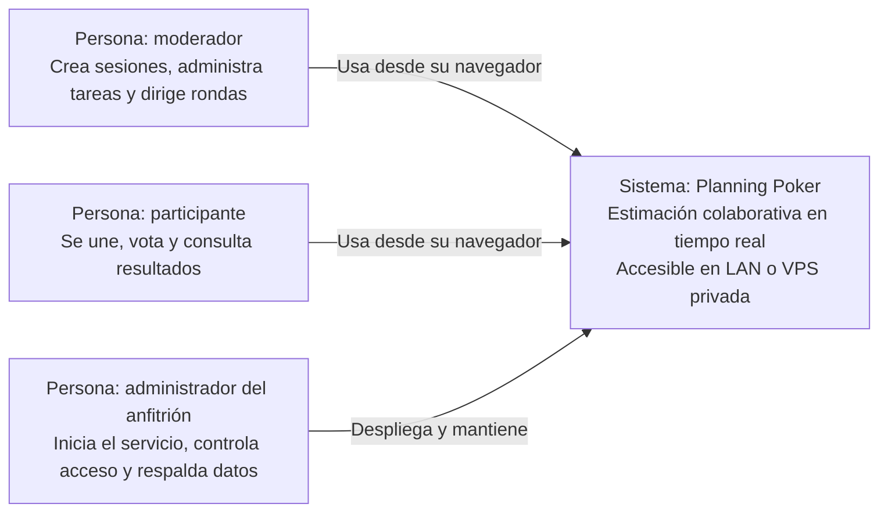
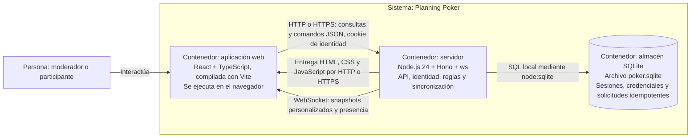
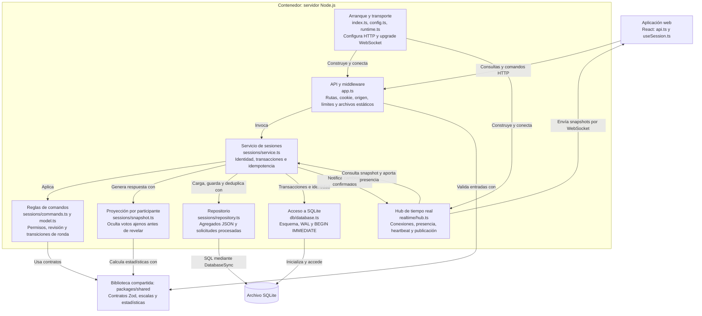
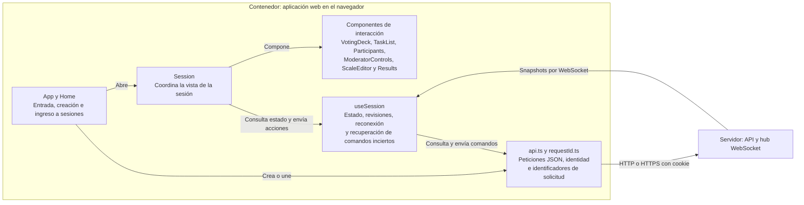
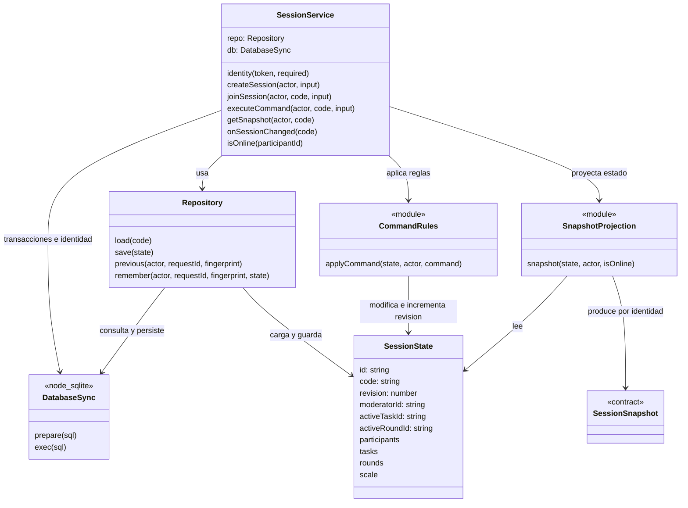
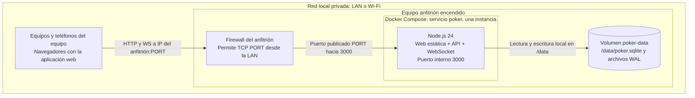
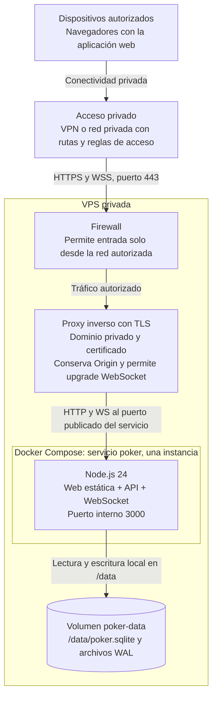

# Arquitectura C4 — Planning Poker

Estos diagramas describen la implementación actual. El alcance de despliegue es una **VPS privada** o un **equipo anfitrión en una LAN**. Se usa Mermaid con notación de personas, sistemas, contenedores y componentes mediante `flowchart`; el nivel de código usa `classDiagram`.

En C4, un contenedor es una aplicación o almacén de datos: no equivale necesariamente a un contenedor Docker. La interfaz se ejecuta en el navegador; el servidor y el archivo SQLite comparten un único contenedor Docker en producción.

## C1 — Contexto del sistema

El moderador también puede votar o facilitar sin votar. No hay dependencias de servicios externos para realizar estimaciones. Compartir el enlace o código se hace fuera del sistema.

## C2 — Contenedores

- La web y la API comparten origen. En producción, Hono entrega también los archivos estáticos.
- Los comandos, incluidos los votos, se envían por HTTP; WebSocket distribuye snapshots del estado y mantiene la presencia.
- SQLite es una biblioteca integrada y un archivo local, sin servidor de base de datos separado.
- `packages/shared` es una biblioteca compilada con los consumidores, no un servicio desplegable.
- Hay una sola réplica del servidor: las conexiones WebSocket, la presencia y los límites de frecuencia viven en memoria.

## C3 — Componentes del servidor

El servicio consulta directamente la tabla de credenciales para resolver la identidad; el repositorio encapsula las sesiones y la deduplicación. El hub solicita una proyección para cada identidad conectada: no transmite el agregado persistido completo.

## C3 — Componentes de la aplicación web

## C4 — Código: núcleo de sesiones

Vista selectiva de los tipos y relaciones principales; no es un inventario exhaustivo. `applyCommand` y `snapshot` son funciones, representadas como módulos.

`activeTaskId` y `activeRoundId` pueden ser nulos. Antes de aplicar un comando se comprueba su idempotencia; los cambios se confirman en SQLite antes de notificar al hub. Las reglas validan pertenencia, permisos y revisión, con tratamiento específico para votos concurrentes de una misma ronda abierta.

## Despliegue A — Equipo local en LAN

- Inicio: `docker compose up --build -d`. Solo el anfitrión necesita Docker.
- Dirección compartida: `http://IP-DEL-ANFITRION:3000`, o el `PORT` elegido. El anfitrión usa esa misma dirección para conservar origen e identidad.
- Configuración: `PUBLIC_ORIGIN=` y `COOKIE_SECURE=false`.
- No requiere abrir puertos del router. El anfitrión debe permanecer encendido y accesible desde la LAN.

## Despliegue B — VPS privada

La siguiente es la topología propuesta para operar de forma privada. La aplicación y el volumen están definidos en el repositorio; el acceso privado, proxy, certificados y reglas de red se configuran fuera de este proyecto.

- Configuración de ejemplo: `PUBLIC_ORIGIN=https://poker.dominio-interno` y `COOKIE_SECURE=true`; el origen debe coincidir exactamente con el utilizado por los navegadores.
- El proxy termina TLS y reenvía HTTP y WebSocket. HTTPS protege el transporte; el carácter privado lo establecen las rutas, VPN y reglas de acceso.
- El Compose actual publica `${PORT:-3000}:3000` sin restringir la dirección de escucha del host. Para esta topología, debe impedirse el acceso directo no autorizado a ese puerto mediante la configuración de publicación y red del despliegue; el proxy no basta por sí solo.
- No hay autenticación corporativa integrada. La cookie HttpOnly identifica al navegador y el servidor controla pertenencia y rol dentro de cada sesión.
- Mantener una sola réplica. La base y los archivos WAL deben persistir en el volumen; las copias coherentes se realizan con el servicio detenido según el README.

## Correspondencia con el repositorio

| Elemento | Fuente |
| --- | --- |
| Arranque y configuración | `apps/server/src/index.ts`, `config.ts`, `runtime.ts` |
| API, identidad HTTP y archivos estáticos | `apps/server/src/app.ts` |
| Servicio, reglas, modelo y proyección | `apps/server/src/sessions/` |
| Persistencia | `apps/server/src/db/database.ts`, `sessions/repository.ts` |
| Tiempo real y presencia | `apps/server/src/realtime/hub.ts` |
| Aplicación web y sincronización | `apps/web/src/` |
| Contratos, escalas y estadísticas | `packages/shared/src/` |
| Empaquetado y despliegue | `Dockerfile`, `compose.yaml`, `README.md` |
